# HỆ THỐNG TƯỚI CÂY TỰ ĐỘNG THEO ĐỘ ẨM ĐẤT SỬ DỤNG ESP32 VÀ THINGSPEAK

> Báo cáo bài tập lớn — Môn **Xây dựng các hệ thống nhúng** — Năm học 2026–2027
> Giảng viên: Đinh Xuân Trường
> Nhóm: **11** — Lớp: D23TXCN11-K
> Tên file nộp: `HTN_TX_2026 Nhóm 11 Lớp N[Y].pdf` `[TODO: xác nhận số thứ tự lớp Y với giảng viên]`
> Mã nguồn: https://github.com/duongtuananh2211/do_am_dat — phiên bản mô tả trong báo cáo: commit `ab6b2f2` (nhánh `feat/sensor-gpio-power`) `[TODO: cập nhật mã commit sau khi đóng băng code]`

**Quy ước trong khung này**

- `[TODO: ...]` — phần nhóm phải tự điền (số đo thực tế, ảnh).
- `> 📝 ...` — ghi chú hướng dẫn, **xóa trước khi xuất PDF**.
- Nội dung không có `TODO` được lấy từ mã nguồn trong repo. Nếu sửa code thì cập nhật lại các phần đó.

---

## Phần 0. Phân chia công việc

| STT | Họ tên | MSSV | Công việc phụ trách | Tỷ lệ (%) |
|---:|---|---|---|---:|
| 1 | Dương Tuấn Anh (nhóm trưởng) | K23DTCN553 | Toàn bộ mã nguồn (firmware ESP32, backend, dashboard), lắp mạch, đo đạc, chụp kết quả; duyệt kỹ thuật báo cáo | `[TODO]` |
| 2 | Trần Lâm Phong | K23DTCN581 | Báo cáo: sơ đồ ghép nối (2.3), tiêu thụ năng lượng (3.2) | `[TODO]` |
| 3 | Bùi Như Quỳnh | K23DTCN582 | Báo cáo: mã nguồn và giải thích (2.5) | `[TODO]` |
| 4 | Nguyễn Văn Thống | K23DTCN584 | Báo cáo: sơ đồ khối, sơ đồ phần mềm (2.1, 2.4), kết quả hệ thống (2.6) | `[TODO]` |
| 5 | Vương Thị Thúy | K23DTCN587 | Báo cáo: giới thiệu (1.1), kết luận, tài liệu tham khảo; biên tập, trình bày | `[TODO]` |
| 6 | Nguyễn Đức Vũ | K23DTCN588 | Báo cáo: yêu cầu phi chức năng (1.4), đánh giá hiệu năng, độ tin cậy, mở rộng (3.1, 3.3–3.5) | `[TODO]` |
| | | | **Tổng** | **100** |

> 📝 Sửa cột "Công việc phụ trách" theo việc mỗi người thực sự làm.

---

## Phần 1. Giới thiệu và đặc tả hệ thống

### 1.1 Bài toán và kịch bản ứng dụng

- **Bối cảnh:** chậu cây hoặc luống rau nhỏ (khoảng 1–2 m²) ở ban công, sân thượng nhà phố, nơi có sẵn WiFi gia đình và ổ điện. Người dùng là chủ nhà đi làm cả ngày hoặc vắng nhà vài ngày; nước tưới lấy từ một xô/bồn chứa đặt cạnh chậu. Họ cần cây được tưới đúng lúc mà không phải có mặt, và muốn mở điện thoại là biết đất đang khô hay ẩm, bơm có chạy không.
- **Vấn đề:** tưới thủ công dễ quên hoặc tưới quá nhiều; không biết tình trạng đất khi đi vắng; hệ tưới tự động mà phụ thuộc Internet thì mất mạng là ngừng tưới.
- **Giải pháp:** ESP32 đo độ ẩm đất khoảng 1,2 s một lần, tự bật bơm khi đất khô và tắt khi đủ ẩm — việc điều khiển chạy **cục bộ**, mất mạng vẫn tưới được. Dữ liệu đẩy lên ThingSpeak; người dùng xem trạng thái, biểu đồ lịch sử, cảnh báo lỗi và ra lệnh bật/tắt bơm từ xa qua dashboard web. Hệ thống tự phát hiện cảm biến hỏng, bồn hết nước, và tự khởi động lại khi firmware treo.

### 1.2 Bảng đặc tả hệ thống

| Thành phần | Mô tả |
|---|---|
| **Input** | • Điện áp analog từ chân AO của cảm biến độ ẩm đất kiểu điện trở (GPIO36, ADC 12-bit, 0–4095), đọc **mỗi ~1.2 s**; mỗi lần cấp nguồn cho cảm biến qua GPIO25, chờ 200 ms rồi lấy trung bình **10 mẫu** cách nhau 2 ms<br>• Lệnh chế độ bơm từ người dùng (`AUTO` / `ON` / `OFF`) qua hàng đợi **ThingSpeak TalkBack**, ESP32 hỏi **mỗi 5 s** |
| **Output** | • Mức logic GPIO26 → kênh 1 relay (kích mức cao) → bật/tắt máy bơm, lưu lượng 1.8 L/phút<br>• Gửi lên ThingSpeak **mỗi 20 s** (gửi sớm khi đổi chế độ, cách lần trước ≥ 15.5 s): độ ẩm (%), trạng thái bơm, chế độ, mã lỗi<br>• Dashboard web: trạng thái, biểu đồ lịch sử, cảnh báo lỗi thiết bị, cảnh báo ESP32 mất kết nối<br>• Log qua Serial 115200 baud |
| **Ràng buộc** | • **Thời gian:** ThingSpeak bản miễn phí chỉ cho ghi vào channel tối thiểu 15 s/lần [4]; bật bơm thủ công tối đa 5 phút; firmware treo > 30 s thì watchdog reset<br>• **Năng lượng:** bơm 12 V DC, 0.6–2 A (5–12 W) → cần adapter 12 V riêng cho bơm, định mức ≥ 2 A (mô hình đang dùng 1 A, xem 2.2); ESP32 + cảm biến + relay cấp 5 V qua cáp USB (cổng USB 2.0 cho tối đa 500 mA)<br>• **Môi trường:** cảm biến hoạt động ở −25 ~ 85 °C; đầu dò cắm trong đất ẩm, mạch đặt gần nguồn nước → cần chống nước cho board ESP32 và module so sánh<br>• **Điện áp cảm biến:** module chịu 3.3–12 V nhưng chân AO phải ≤ 3.3 V để an toàn cho ADC ESP32 → cấp 3.3 V<br>• **Mạng:** WiFi 2.4 GHz; mất mạng vẫn điều khiển cục bộ |

### 1.3 Yêu cầu chức năng

| Mã | Yêu cầu |
|---|---|
| FR1 | Đo độ ẩm đất và quy đổi sang phần trăm 0–100 % |
| FR2 | Chế độ **Tự động**: bật bơm khi độ ẩm < 30 %, tắt khi độ ẩm ≥ 60 % |
| FR3 | Chế độ **Thủ công**: bật hoặc tắt bơm theo lệnh từ dashboard, bỏ qua độ ẩm; bật thủ công tối đa **5 phút** rồi tự về Tự động |
| FR4 | Gửi độ ẩm, trạng thái bơm, chế độ, mã lỗi lên cloud định kỳ |
| FR5 | Dashboard hiển thị độ ẩm, trạng thái bơm, chế độ, thời điểm cập nhật, biểu đồ lịch sử, cảnh báo lỗi và cảnh báo khi ESP32 ngừng gửi dữ liệu |
| FR6 | Dashboard cho phép đổi chế độ bơm (qua hàng đợi lệnh TalkBack) |
| FR7 | Mất WiFi: vẫn đo và điều khiển bơm cục bộ; tự kết nối lại; offline > 60 s khi đang ở chế độ thủ công thì về Tự động |
| FR8 | Phát hiện cảm biến lỗi (ADC ngoài dải hợp lệ) → chế độ Tự động tắt bơm, báo lỗi |
| FR9 | Phát hiện bơm không hiệu quả (bơm 3 phút mà độ ẩm tăng < 5 % — hết nước, tắc ống) → tắt bơm, báo lỗi, chờ người dùng xác nhận |
| FR10 | Tự khởi động lại khi firmware treo (watchdog) |

### 1.4 Yêu cầu phi chức năng

Kết quả đo ngày 10/11/2026 trên mạch thật, firmware `ab6b2f2`, WiFi 2.4 GHz trong nhà; chi tiết cách đo và số liệu ở 3.1, log gốc trong thư mục `logs/` của báo cáo.

| Mã | Yêu cầu | Chỉ tiêu | Kết quả đo |
|---|---|---|---|
| NFR1 | Độ trễ điều khiển cục bộ (đất khô → bơm bật, chế độ Auto) | ≤ 2 s | **Đạt một phần:** ≤ 1.44 s ở 7/11 lần; 4/11 lần 3.4–6.8 s do request HTTP chặn vòng lặp (3.1) |
| NFR2 | Độ trễ lệnh từ xa (bấm nút → ESP32 đổi chế độ) | ≤ 10 s | **Đạt:** TB 3.97 s, min 0.92, max 7.51 (n = 5); 1/6 lệnh bị mất do lỗi mạng (3.3) |
| NFR3 | Chu kỳ cập nhật dữ liệu lên cloud | 20 s | **Đạt:** TB 20.66 s, min 16.71, max 24.21 (n = 25) |
| NFR4 | Sai số độ ẩm so với mốc hiệu chuẩn | ≤ ±5 % | Đạt: ±1 % sau khi đầu dò ổn định trong nước (ADC 539–603 → 99–100 %), ngoài không khí 0 % (xem 2.2) |
| NFR5 | Thời gian khởi động đến khi gửi được gói đầu tiên | ≤ 30 s | **Đạt:** TB 3.79 s, min 3.36, max 4.13 (n = 7) |
| NFR6 | Dòng tiêu thụ trung bình của phần điều khiển (không tính bơm) | ≤ 250 mA @ 5 V (relay nhả); đỉnh < 500 mA (giới hạn USB 2.0) | **Ước tính, chưa đo:** ~105 mA (80–130 mA) ≈ 0.5 W; đỉnh ~370 mA (3.2) |
| NFR7 | Bơm không bật/tắt liên tục quanh ngưỡng | Có vùng trễ 30–60 % | Đạt (thiết kế) |
| NFR8 | Chu kỳ điều khiển khi mất WiFi | ≤ 2 s (không bị chặn) | **Đạt:** TB 1220 ms, max 1229 ms (n = 104 vòng, mất mạng 127 s) |
| NFR9 | Thời gian tự phục hồi khi firmware treo | ≤ 30 s (watchdog) | **Đạt:** watchdog kích sau TB 29.98 s (29.90–30.11, n = 5); tính cả khởi động lại, hệ thống chạy lại sau TB 32.91 s |
| NFR10 | Lượng nước tối đa mỗi lần bật thủ công | ≤ 9 L (5 phút × 1.8 L/phút) | Đạt (thiết kế) |

---

## Phần 2. Thiết kế hệ thống

### 2.1 Sơ đồ khối hệ thống

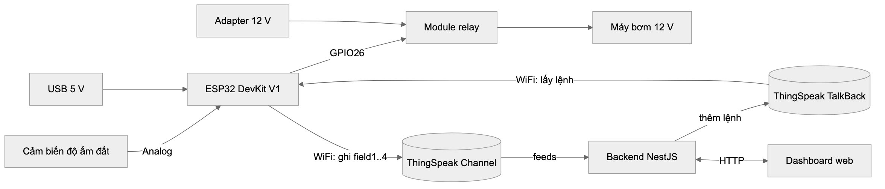

*Hình 2.1. Sơ đồ khối hệ thống*

> 📝 Ảnh trên render từ khối mermaid dưới đây (nguồn: `hinh/src/*.mmd`). Khi chuyển sang Word chỉ giữ ảnh, bỏ khối code mermaid.

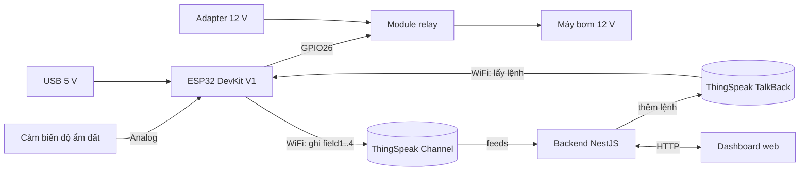

| Khối | Chức năng |
|---|---|
| Cảm biến độ ẩm | Chuyển độ ẩm đất thành điện áp analog |
| ESP32 | Đọc ADC, quyết định bật/tắt bơm, phát hiện lỗi, giao tiếp WiFi |
| Relay | Cách ly mạch điều khiển 3.3 V với mạch công suất của bơm |
| Máy bơm | Cấp nước cho cây |
| ThingSpeak Channel | Lưu dữ liệu đo (chỉ ESP32 ghi) |
| ThingSpeak TalkBack | Hàng đợi lệnh từ dashboard tới ESP32 |
| Backend NestJS | Che API key; `GET /api/status`, `GET /api/history`, `POST /api/pump/mode` |
| Dashboard | Hiển thị trạng thái, biểu đồ lịch sử, cảnh báo lỗi, gửi lệnh đổi chế độ |

### 2.2 Thiết kế phần cứng

#### Danh sách linh kiện

| STT | Linh kiện | Thông số chính | Chức năng | Lý do chọn |
|---:|---|---|---|---|
| 1 | ESP32 DevKit V1 | Dual-core 240 MHz, WiFi 2.4 GHz, ADC 12-bit [1] | Bộ xử lý trung tâm | Có sẵn WiFi, không cần module mạng rời; ADC 12-bit đủ phân giải; có sẵn Task Watchdog phần cứng/phần mềm; giá rẻ; hỗ trợ Arduino/PlatformIO |
| 2 | Cảm biến độ ẩm đất kiểu điện trở (đầu dò 2 cực + module so sánh LM393 [7]) | DC 3.3–12 V; dòng < 20 mA; ngõ ra AO (analog) và DO (số, mức thấp khi ẩm hơn ngưỡng đặt bằng biến trở); −25 ~ 85 °C; module 36 × 15 × 7 mm | Đo độ ẩm | Chạy được ở 3.3 V nên cắm thẳng vào ESP32 không cần mạch chia áp; có ngõ AO cho phép đặt ngưỡng bằng phần mềm; giá rẻ, phổ biến |
| 3 | Module relay 2 kênh 5 V có opto cách ly | Nguồn 5 V DC; tiếp điểm 10 A/250 VAC hoặc 10 A/30 VDC [8]; opto PC817 [9]; ngõ vào TTL; chọn kích mức cao/thấp bằng jumper; 142 × 52 × 18 mm, ~118 g | Đóng/ngắt bơm (dùng kênh 1, kênh 2 dự phòng) | GPIO ESP32 chỉ cấp được dòng nhỏ, không chạy trực tiếp bơm; opto cách ly mạch điều khiển 3.3 V khỏi nhiễu của cuộn relay và động cơ bơm; tải 10 A dư nhiều so với bơm mini; ngõ vào TTL nhận được mức 3.3 V của ESP32; kênh 2 sẵn cho mở rộng |
| 4 | Máy bơm mini 12 V DC | 12 V DC; 0.6–2 A; 5–12 W; lưu lượng 1.8 L/phút; chịu nhiệt tới 80 °C; 90 × 40 × 35 mm | Bơm nước từ bồn chứa ra chậu/luống | Lưu lượng 1.8 L/phút đủ cho chậu/luống nhỏ; dòng tối đa 2 A @ 12 V nằm trong khả năng tiếp điểm relay (10 A/30 VDC) với hệ số an toàn ~5 lần; kích thước nhỏ gọn |
| 5 | Adapter 12 V DC 1 A (đang dùng trong mô hình) | 12 V, 1 A (12 W) | Cấp nguồn cho bơm qua tiếp điểm relay | Nguồn riêng cho bơm vì bơm 12 V không lấy chung từ USB được. **Chưa đủ cho mọi tải:** bơm ăn 0.6 A khi tải nhẹ (đủ) nhưng tới 2 A khi tải nặng hoặc lúc khởi động — vượt định mức 1 A. Thiết kế yêu cầu adapter **≥ 2 A** (dư ~20 % so với dòng đỉnh); mô hình dùng tạm adapter 1 A có sẵn, chấp nhận rủi ro ở 3.3 và 3.5 |
| 6 | Cáp USB (từ máy tính hoặc cốc sạc 5 V) | 5 V, ≤ 500 mA (USB 2.0) | Cấp cho ESP32; ESP32 đưa 5 V ra chân VIN cho relay, cảm biến lấy 3.3 V từ GPIO25 | Dùng luôn cổng nạp code nên vừa cấp nguồn vừa xem Serial log; mạch ổn áp trên DevKit tạo sẵn 3.3 V; tách hẳn nguồn điều khiển khỏi nguồn bơm 12 V nên nhiễu động cơ không làm ESP32 reset |
| 7 | Dây, breadboard, ống nước | | | |

**Nguyên lý cảm biến.** Đất càng ẩm thì điện trở giữa hai cực đầu dò càng nhỏ. Module mắc đầu dò trong cầu phân áp nên điện áp AO **giảm khi đất ẩm lên**. Vì vậy mốc khô trong code (`ADC_DRY`) lớn hơn mốc ướt (`ADC_WET`). Ngõ DO là đầu ra của bộ so sánh LM393, chỉ cho biết đang trên hay dưới một ngưỡng chỉnh bằng biến trở. Hệ thống dùng AO vì cần giá trị % liên tục, vì có hai ngưỡng 30 %/60 % do phần mềm đặt, và vì cần giá trị ADC thô để phát hiện cảm biến lỗi (FR8).

**Hiệu chuẩn.** `ADC_DRY` = ADC khi đầu dò để ngoài không khí, `ADC_WET` = ADC khi nhúng nước, mỗi mốc lấy từ log `[Sensor] ADC raw` (log gốc trong thư mục `logs/`). Kết quả: **`ADC_DRY = 4095`** (cả 15 lần đọc đều bão hòa ADC), **`ADC_WET = 580`** (trung bình 60 s cuối sau khi ổn định: 581, min 539, max 603, độ lệch chuẩn 12.9).

Quá trình hiệu chuẩn phát hiện hai hiện tượng làm thay đổi thiết kế ban đầu (cảm biến cấp nguồn thẳng từ chân 3V3):

1. **Trôi số đo do phân cực điện cực.** Cấp điện một chiều liên tục, đầu dò nhúng nước cho ADC tăng đều khoảng 100 đơn vị/phút và không dừng. Nguyên nhân là ion trong nước dồn về hai điện cực (phân cực, điện phân), làm điện trở đo được tăng dần; về lâu dài đây cũng là cơ chế ăn mòn điện cực. Giải pháp: chuyển chân VCC của cảm biến sang **GPIO25**, chỉ bật nguồn trong lúc đọc rồi tắt ngay (xem 2.3, 2.5a).
2. **Điện áp AO lên chậm sau khi cấp nguồn.** Đo AO mỗi 2 ms sau khi bật GPIO25: trong nước AO ổn định gần như tức thời, nhưng ngoài không khí AO tăng theo dạng nạp RC với hằng số thời gian τ ≈ 45 ms, khoảng 110 ms mới đạt 4095. Lần thử đầu chỉ chờ 20 ms nên ngoài không khí đọc ra 2780 thay vì 4095 — đất khô sẽ bị đọc thành ẩm hơn thực tế. Vì vậy firmware chờ **200 ms (~4.5 τ)** rồi mới lấy mẫu.

| Cách cấp nguồn cảm biến | Tỷ lệ thời gian có điện | ADC khi vừa nhúng nước | Sau 4.5 phút | Đánh giá |
|---|---:|---:|---:|---|
| 3V3 liên tục (thiết kế ban đầu) | 100 % | ~1040 | ~1440, vẫn tăng ~100/phút | Trôi ≈ 13 % thang đo, không ổn định |
| GPIO25, chờ 200 ms + 10 mẫu × 2 ms | ~18 % (~220 ms / 1.22 s) | ~420 | ~580, ổn định từ phút thứ 2 (σ = 12.9 ≈ 0.4 %) | Đạt NFR4 |

> 📝 Hai lần đo trên cách nhau vài phút, cùng cốc nước, cùng độ sâu nhúng; giá trị tuyệt đối khác nhau vì điện cực còn phân cực dư từ lần đo trước, nên chỉ so sánh **xu hướng trôi**.

#### Phân tích phương án thay thế

| Thành phần | Đã chọn | Phương án thay thế | Lý do không chọn |
|---|---|---|---|
| MCU | ESP32 | ESP8266 | Chỉ 1 ADC 10-bit, dải 0–1 V, ít GPIO |
| MCU | ESP32 | Arduino Uno + module WiFi | Thêm module, tốn chân, code phức tạp hơn |
| Cảm biến | Điện trở + LM393 | Cảm biến điện dung (Capacitive v1.2) | Điện dung không bị ăn mòn điện cực, bền hơn khi cắm lâu ngày, nhưng giá cao hơn và cần nguồn ổn định; loại điện trở đủ cho mô hình thử nghiệm — là hướng nâng cấp ở 3.5 |
| Cảm biến | Đọc ngõ AO | Chỉ đọc ngõ DO | DO chỉ có 2 mức, không có giá trị % để hiển thị, không làm được vùng trễ 30–60 % và không phát hiện được cảm biến lỗi |
| Bơm | Bơm 12 V, 1.8 L/phút | Bơm chìm mini 3–5 V (cấp qua USB) | Gọn, dùng chung nguồn 5 V, nhưng lưu lượng thấp và đẩy nước kém, chỉ hợp chậu rất nhỏ |
| Nguồn ESP32 | Cáp USB 5 V riêng | Hạ áp từ adapter 12 V bằng mạch buck (VD LM2596) | Chỉ cần 1 adapter, gọn hơn khi lắp đặt cố định; nhưng chung nguồn với bơm nên dễ nhiễu/sụt áp khi bơm khởi động — là hướng nâng cấp khi đóng hộp sản phẩm |
| Chuyển mạch bơm | Relay | MOSFET (VD: IRLZ44N) | MOSFET nhỏ gọn, không có tiếng kêu, điều khiển PWM được — có thể là cải tiến sau |
| Cloud | ThingSpeak (Channel + TalkBack) | MQTT (HiveMQ/Mosquitto), Blynk, Firebase | ThingSpeak miễn phí, có thư viện chính thức [6], có sẵn lưu trữ và biểu đồ, TalkBack có sẵn hàng đợi lệnh [5]; đổi lại phải hỏi lệnh theo chu kỳ (polling) và giới hạn 15 s/lần ghi channel. MQTT đẩy lệnh tức thời nhưng phải tự dựng broker và lưu trữ |
| Kênh lệnh | TalkBack | Dashboard ghi lệnh vào một field của channel | Dùng chung channel với ESP32 → lệnh bị dữ liệu định kỳ ghi đè, đụng giới hạn 15 s, sinh entry thiếu field (đã gặp ở phiên bản đầu — xem 3.5) |

### 2.3 Sơ đồ ghép nối

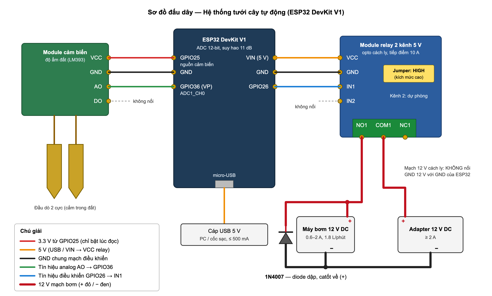

*Hình 2.2. Sơ đồ đấu dây (nguồn vẽ: `hinh/src/h2-3_so_do_dau_day.svg`)*

> 📝 Hình có diode 1N4007 song song bơm (checklist mục 2). Nếu mạch thật chưa lắp diode thì lắp vào, hoặc xóa diode khỏi SVG và bỏ dòng "Diode 1N4007" ở bảng dưới. Ảnh mạch thật đặt ở 2.6 (H1).

| Từ | Đến | Lý do |
|---|---|---|
| Cảm biến VCC (+) | **GPIO25** (mức cao = 3.3 V) | Chỉ cấp điện cho cảm biến lúc đọc (~220 ms mỗi vòng) để giảm phân cực/ăn mòn điện cực (xem 2.2). Mức 3.3 V giữ AO ≤ 3.3 V, an toàn cho ADC; cấp 5 V có thể làm hỏng chân ADC. Module dùng < 20 mA, trong khả năng của GPIO (đặt drive mạnh nhất ~40 mA). GPIO25 không phải strapping pin; dù thuộc ADC2 nhưng ở đây chỉ dùng làm ngõ ra số nên không xung đột WiFi |
| Cảm biến GND (−) | ESP32 GND | Chung mass |
| Cảm biến AO | **GPIO36 (VP)** | Thuộc **ADC1** — ADC2 không dùng được khi WiFi đang hoạt động [2], [3]; GPIO36 chỉ là chân vào nên không xung đột chức năng khác |
| Cảm biến DO | Không nối | Ngưỡng do phần mềm xử lý trên AO (xem 2.2) |
| Đầu dò (2 dây) | Module so sánh | Đầu dò cắm đất, module đặt nơi khô ráo |
| Cáp USB | Cổng micro-USB của ESP32 DevKit | Cấp 5 V cho toàn bộ mạch điều khiển, đồng thời nạp code và đọc Serial |
| Relay VCC | ESP32 VIN (5 V từ USB) | Cuộn relay cần 5 V; chân 3V3 của ESP32 không đủ áp |
| Relay GND | ESP32 GND | Chung mass để mức logic IN có cùng điện thế tham chiếu |
| Relay IN1 | **GPIO26** | Chân output thường, không phải strapping pin nên không ảnh hưởng lúc boot |
| Relay IN2 | Không nối | Kênh dự phòng cho mở rộng (3.4) |
| Jumper kích hoạt | **HIGH Trigger** | Code bật bơm bằng `digitalWrite(RELAY_PIN, HIGH)`. Lúc ESP32 reset/khởi động (kể cả khi watchdog reset), GPIO26 ở mức thấp → với kích mức cao, relay **giữ nguyên trạng thái tắt**; nếu để LOW Trigger, bơm sẽ tự bật trong lúc boot |
| Adapter 12 V (+) | Relay COM1 | Relay chỉ ngắt dây dương của mạch bơm |
| Relay NO1 | Bơm (+) | Dùng tiếp điểm **thường mở**: mất điện điều khiển thì bơm tắt (an toàn) |
| Bơm (−) | Adapter 12 V (−) | Mạch công suất 12 V tách riêng, **không** nối chung mass với ESP32 — opto trên module relay đảm nhận cách ly |
| Diode 1N4007 | Song song với bơm, catốt về (+), anốt về (−) | Bơm là tải cảm: lúc relay ngắt, cuộn dây động cơ sinh xung điện áp ngược. Diode dẫn dòng này vòng qua bơm, giảm tia lửa ở tiếp điểm relay và nhiễu lan sang mạch điều khiển. Lúc bơm chạy diode phân cực ngược nên không dẫn |

Cấu hình ADC trong code: độ phân giải 12-bit (`analogSetWidth(12)`), suy hao 11 dB (`analogSetAttenuation(ADC_11db)`) để đo được dải điện áp đến ~3.3 V [3].

### 2.4 Thiết kế phần mềm

#### Kiến trúc tổng thể

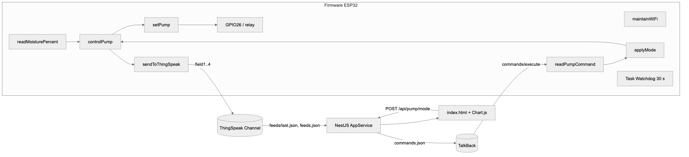

*Hình 2.3. Kiến trúc phần mềm*

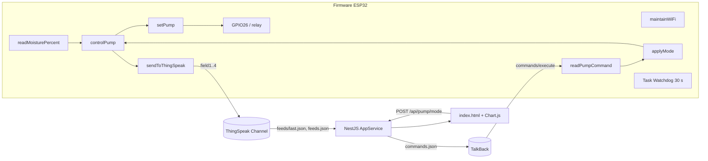

Kênh dữ liệu và kênh lệnh **tách riêng**: chỉ ESP32 ghi vào Channel, chỉ dashboard ghi vào TalkBack. Mỗi bên chỉ đọc kênh của bên kia → không bên nào ghi đè dữ liệu của bên nào.

#### Sơ đồ luồng firmware

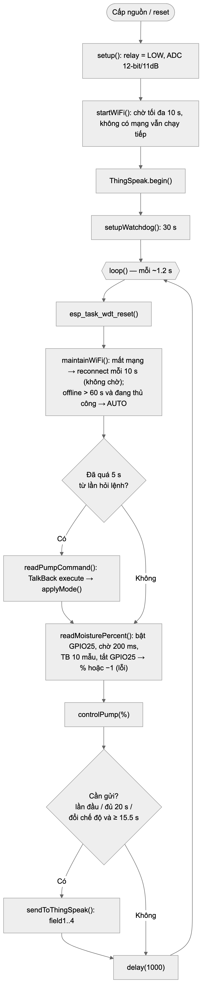

*Hình 2.4. Sơ đồ luồng firmware*

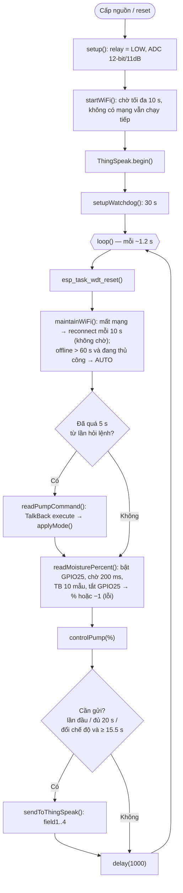

#### Máy trạng thái chế độ (`pumpMode`)

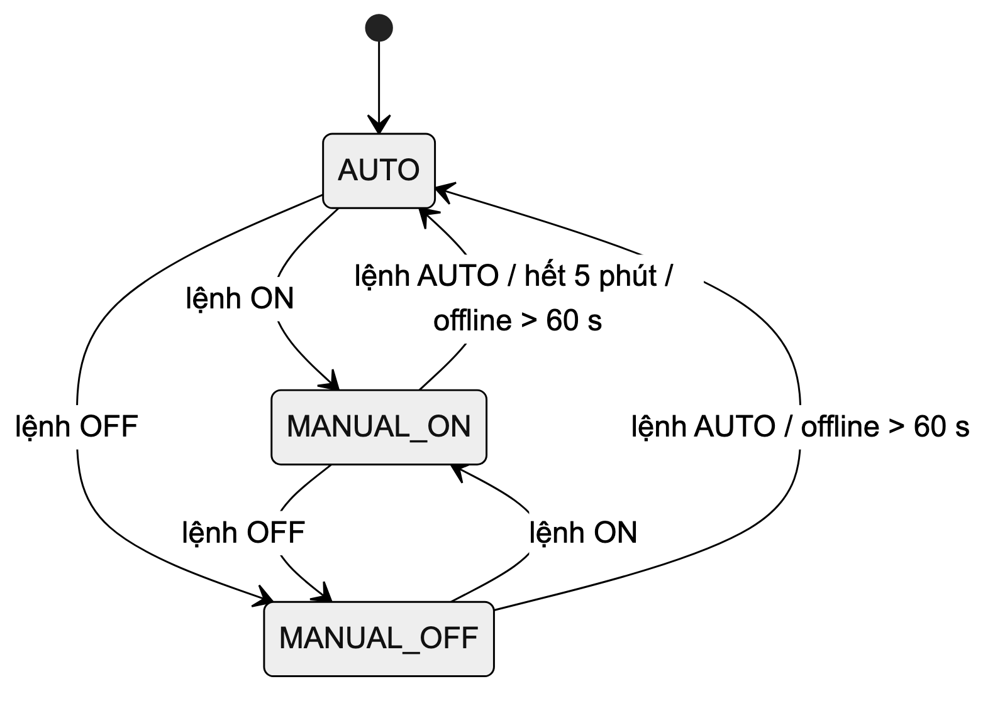

*Hình 2.5. Máy trạng thái chế độ*

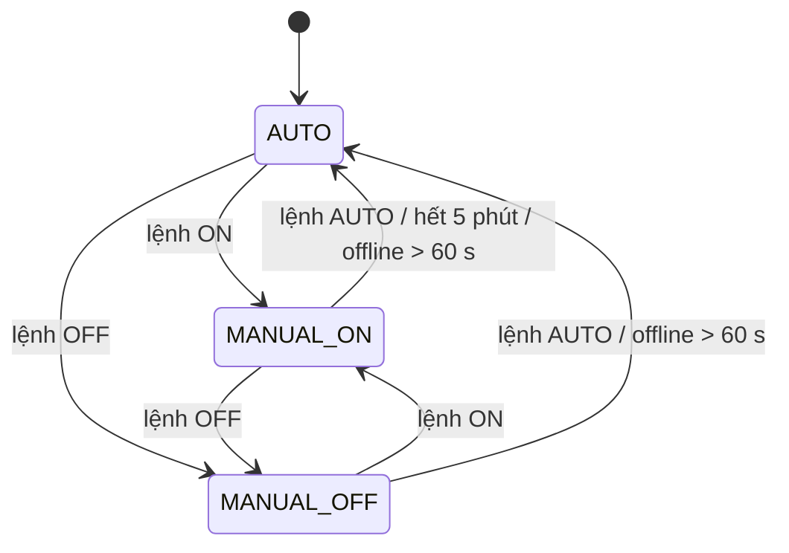

#### Máy trạng thái bơm trong chế độ AUTO (`controlPump`)

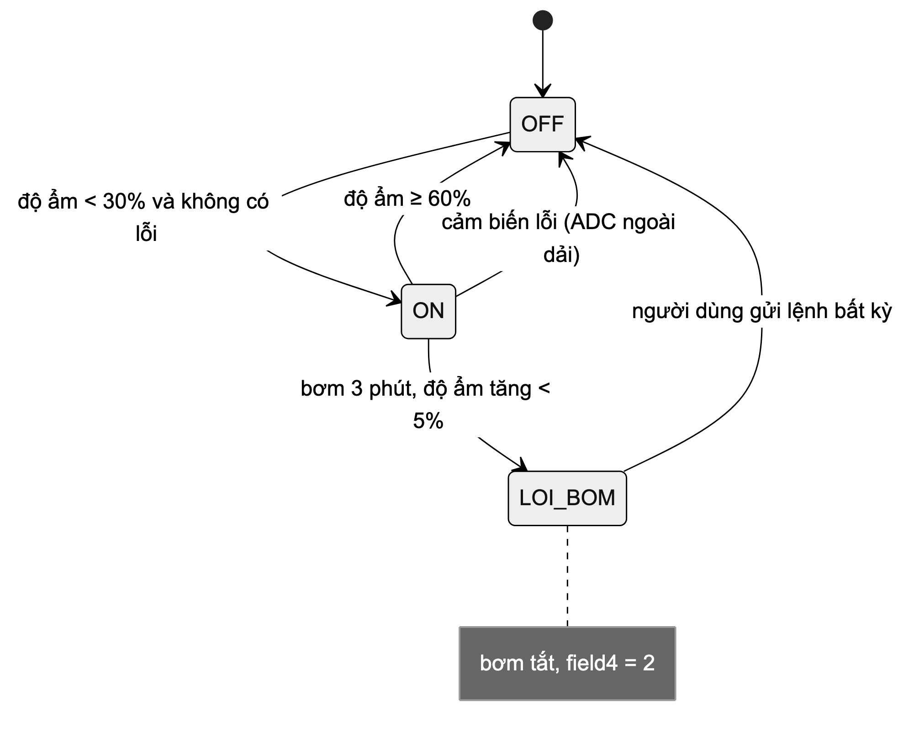

*Hình 2.6. Máy trạng thái bơm trong chế độ AUTO*

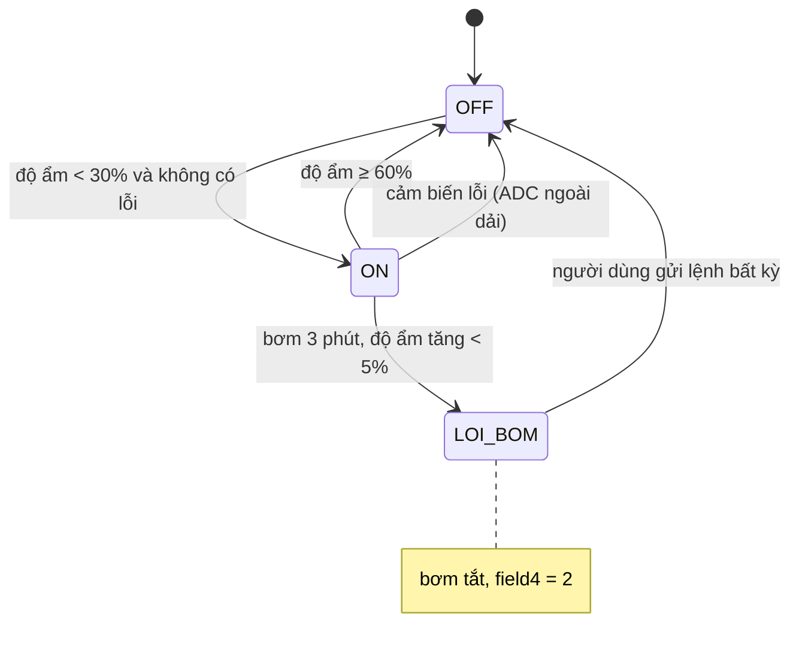

### 2.5 Mã nguồn và giải thích

> 📝 Đề **không chấp nhận** chỉ comment từng dòng. Mỗi mục: (1) ứng với khối nào trong sơ đồ luồng 2.4, (2) ý tưởng xử lý, (3) đoạn code ngắn nhất. Các đoạn code dưới đây đã **rút gọn** (bỏ log Serial).

**Tổng quan.** Firmware chạy theo mô hình *super-loop* không dùng RTOS: `loop()` lặp mỗi ~1.2 s. Đọc cảm biến và điều khiển bơm chạy ở **mọi** vòng lặp, không phụ thuộc mạng. Các tác vụ mạng (hỏi lệnh, gửi dữ liệu) được giãn chu kỳ bằng `millis()` và **không bao giờ chờ kết nối**: mất WiFi thì bỏ qua lượt đó. Riêng một request HTTP khi đang có mạng vẫn là lời gọi đồng bộ, chặn vòng lặp tới khi có phản hồi (đo được 1–5 s, xem 3.1). Mọi trạng thái nguy hiểm (bơm chạy quá lâu, cảm biến sai, firmware treo) đều có cơ chế tự thoát về trạng thái an toàn là **bơm tắt**.

#### a) Đọc cảm biến và phát hiện lỗi — `readMoisturePercent()` (`src/main.cpp:173`)

Khối *readMoisturePercent* trong sơ đồ luồng. Bật nguồn cảm biến qua GPIO25, chờ 200 ms cho AO ổn định, lấy trung bình 10 mẫu để lọc nhiễu rồi tắt nguồn ngay — cảm biến chỉ có điện ~18 % thời gian, giảm trôi số đo do phân cực điện cực (đo ở 2.2). Sau đó kiểm tra ADC có nằm trong dải hợp lệ không (FR8) và quy đổi tuyến tính hai mốc hiệu chuẩn ra %. Trả về `-1` để báo lỗi cho `controlPump()`.

```cpp
int readMoisturePercent() {
  digitalWrite(SENSOR_POWER_PIN, HIGH);   // GPIO25 cấp nguồn cảm biến
  delay(SENSOR_SETTLE_MS);                // 200 ms ≈ 4.5 τ của mạch RC ở AO
  long sum = 0;
  for (int i = 0; i < 10; i++) { sum += analogRead(MOISTURE_PIN); delay(2); }
  digitalWrite(SENSOR_POWER_PIN, LOW);    // ngắt nguồn ngay sau khi đọc
  int adcValue = sum / 10;

  bool fault = adcValue < SENSOR_FAULT_LOW ||              // = 50
               adcValue > ADC_DRY + SENSOR_FAULT_MARGIN;   // không bao giờ xảy ra vì ADC_DRY = 4095
  sensorFault = fault;
  if (fault) return -1;

  int percent = map(adcValue, ADC_DRY, ADC_WET, 0, 100);
  return constrain(percent, 0, 100);
}
```

Rời dây VCC → AO về 0 → dưới `SENSOR_FAULT_LOW` = 50 → báo lỗi thay vì báo "đất rất ẩm". Ngưỡng ban đầu là `ADC_WET − 300` = 280, nhưng đo thực tế cho thấy đầu dò để yên trong nước, ngay sau khi khởi động lại, đọc chỉ 126–280 rồi mới tăng dần lên ~580 (điện cực hết phân cực trong lúc không được cấp điện) → firmware báo lỗi nhầm ở các lần đọc đầu. Ngưỡng 50 chừa khoảng 2.5 lần so với giá trị thấp nhất đo được trong nước. Ngược lại, vì `ADC_DRY` = 4095 đã chạm trần ADC nên ngưỡng trên `ADC_DRY + 300` không bao giờ vượt: đứt dây đầu dò cho kết quả giống hệt đất khô (xem 3.3).

#### b) Điều khiển bơm — `controlPump()` (`src/main.cpp:282`)

Khối *controlPump*. Thứ tự ưu tiên: (1) hết hạn 5 phút thủ công → về AUTO; (2) chế độ thủ công; (3) AUTO: có lỗi thì tắt bơm, không lỗi thì so ngưỡng có **vùng trễ** 30 %/60 % — nếu chỉ dùng 1 ngưỡng, độ ẩm dao động quanh ngưỡng làm relay đóng/ngắt liên tục.

```cpp
if (pumpMode == MANUAL_ON && now - manualOnSince >= MANUAL_ON_MAX_MS) {
  pumpMode = AUTO;  forceSend = true;           // hết 5 phút thủ công
}
if (pumpMode == MANUAL_ON)  { setPump(true,  "thủ công"); return; }
if (pumpMode == MANUAL_OFF) { setPump(false, "thủ công"); return; }

// AUTO
if (sensorFault || pumpFault) { setPump(false, "tự động — lỗi"); return; }
if (!pumpRunning && moisturePercent < MOISTURE_LOW)            setPump(true,  ...);
else if (pumpRunning && moisturePercent >= MOISTURE_HIGH)    { setPump(false, ...); return; }
```

**Kiểm tra bơm hiệu quả (FR9).** Khi bơm đang chạy ở AUTO, cứ mỗi 3 phút so độ ẩm với mốc đầu chu kỳ; tăng chưa tới 5 % thì coi như hết nước/tắc ống, tắt bơm và **chốt** lỗi (`pumpFault`) cho tới khi người dùng gửi lệnh mới — tránh hệ thống tự bật lại bơm chạy khô.

```cpp
if (pumpRunning) {
  if (!autoCheckArmed) { autoCheckArmed = true; autoCheckSince = now; autoCheckMoisture = moisturePercent; }
  else if (now - autoCheckSince >= AUTO_ON_MAX_MS) {
    if (moisturePercent - autoCheckMoisture < AUTO_MIN_RISE) { pumpFault = true; setPump(false, ...); }
    else { autoCheckSince = now; autoCheckMoisture = moisturePercent; }
  }
}
```

`setPump()` (`src/main.cpp:273`) chỉ gọi `digitalWrite` khi trạng thái thực sự đổi.

#### c) Nhận lệnh từ xa — `readPumpCommand()` (`src/main.cpp:233`)

Khối *readPumpCommand*. Gọi API `commands/execute` của TalkBack: server trả lệnh kế tiếp **và xóa nó khỏi hàng đợi**, hàng đợi rỗng thì trả chuỗi rỗng. Nhờ đó mỗi lệnh được thực hiện đúng một lần, không thể bị ghi đè.

```cpp
String url = String("http://api.thingspeak.com/talkbacks/") + TALKBACK_ID + "/commands/execute";
http.begin(tbClient, url);
http.addHeader("Content-Type", "application/x-www-form-urlencoded");
int    httpCode = http.POST(String("api_key=") + TALKBACK_API_KEY);
String body     = httpCode == 200 ? http.getString() : String();
...
if (body.length() == 0) return;                       // không có lệnh mới
if      (body == "AUTO") applyMode(AUTO, "TalkBack");
else if (body == "ON")   applyMode(MANUAL_ON, "TalkBack");
else if (body == "OFF")  applyMode(MANUAL_OFF, "TalkBack");
```

`applyMode()` (`src/main.cpp:213`) đổi chế độ, xóa cờ `pumpFault`, nhận `ON` thì đặt lại mốc 5 phút, và bật `forceSend` để báo trạng thái mới lên dashboard sớm.

#### d) Gửi dữ liệu — `sendToThingSpeak()` (`src/main.cpp:347`) và điều kiện gửi trong `loop()`

Khối *sendToThingSpeak*. Ghi cả 4 field trong 1 request. Cảm biến lỗi thì **bỏ trống field1** (dashboard hiện "—") thay vì gửi số sai.

```cpp
if (moisturePercent >= 0) ThingSpeak.setField(1, moisturePercent);
ThingSpeak.setField(2, pumpRunning ? 1 : 0);
ThingSpeak.setField(3, (int)pumpMode);
ThingSpeak.setField(4, (int)currentError());   // 0 / 1 cảm biến lỗi / 2 bơm không hiệu quả
int result = ThingSpeak.writeFields(CHANNEL_ID, WRITE_API_KEY);
```

Điều kiện gửi (`src/main.cpp:443`): lần đầu có mạng, hoặc đủ 20 s, hoặc chế độ vừa đổi và đã cách lần trước ≥ 15.5 s (giới hạn 15 s của ThingSpeak).

```cpp
bool sendDue = (!sentOnce && online) ||
               now - lastSendTime >= SEND_INTERVAL_MS ||
               (forceSend && online && now - lastSendTime >= MIN_WRITE_GAP_MS);
```

#### e) WiFi không chặn — `maintainWiFi()` (`src/main.cpp:135`)

Khối *maintainWiFi*. Gọi đầu mỗi vòng lặp; mất mạng thì gọi `WiFi.reconnect()` mỗi 10 s rồi đi tiếp ngay, nên đọc cảm biến và điều khiển bơm không bao giờ bị kẹt chờ mạng (FR7). Đang ở chế độ thủ công mà offline quá 60 s thì về AUTO, vì người dùng không còn điều khiển từ xa được.

```cpp
if (now - lastWifiAttempt >= WIFI_RETRY_MS) { WiFi.reconnect(); lastWifiAttempt = now; }
if (pumpMode != AUTO && now - offlineSince >= OFFLINE_FALLBACK_MS) {
  pumpMode = AUTO;  forceSend = true;
}
```

#### f) Watchdog — `setupWatchdog()` (`src/main.cpp:380`)

Khối *Task Watchdog*. Đăng ký task `loop()` với Task Watchdog Timer của ESP-IDF [3], timeout 30 s; mỗi vòng lặp gọi `esp_task_wdt_reset()`. Nếu một request HTTP bị kẹt quá 30 s, ESP32 tự reset; `setup()` khởi tạo relay LOW nên bơm luôn tắt sau reset (FR10). Code có hai nhánh cho Arduino-ESP32 2.x và 3.x vì API watchdog đổi giữa hai bản.

#### g) Backend và dashboard — `dashboard/src/app.service.ts`, `public/index.html`

- Backend giữ mọi key trong `.env`, trình duyệt không thấy key. Backend chỉ **đọc** channel và chỉ **ghi** vào TalkBack.
- `getStatus()` đọc `feeds/last.json`; `getHistory(N)` đọc `feeds.json?results=N` cho biểu đồ.
- `setPumpMode()` đưa lệnh vào hàng đợi:

  ```ts
  const url  = `https://api.thingspeak.com/talkbacks/${this.talkbackId}/commands.json`;
  const body = new URLSearchParams({ api_key: this.talkbackApiKey, command_string: TALKBACK_COMMANDS[mode] });
  await axios.post(url, body, { timeout: 8000 });
  ```
- Dashboard tự làm mới mỗi 15 s; vẽ biểu đồ độ ẩm + trạng thái bơm + hai đường ngưỡng bằng Chart.js; hiện cảnh báo theo field4; dữ liệu cũ hơn 90 s thì báo "ESP32 không gửi dữ liệu mới".

### 2.6 Kết quả hệ thống

Các hình Serial dưới đây trích nguyên văn từ log ghi trên mạch thật ngày 10/11/2026 (thư mục `logs/`), chỉ lược bớt các dòng lặp lại (dấu ⋮). Cột giờ bên trái là giờ máy tính ghi log; `t=` là `millis()` của ESP32.

| Hình | Nội dung | Chứng minh |
|---|---|---|
| 2.7 (H1) | Ảnh mạch thật đã lắp | Phần cứng khớp sơ đồ 2.3 |
| 2.8 (H2) | Serial khi khởi động, kết nối WiFi | Khởi động, NFR5 |
| 2.9 (H3) | Serial: bơm bật khi khô, tắt khi đủ ẩm | FR2, vùng trễ (NFR7) |
| 2.10 (H4) | Dashboard: biểu đồ lịch sử qua ≥ 1 chu kỳ tưới | FR4, FR5 |
| 2.11 (H5) | Dashboard bấm "Bật bơm" + Serial đổi chế độ | FR3, FR6, NFR2 |
| 2.12 (H6) | Rút dây cảm biến → báo lỗi | FR8 |
| 2.13 (H7) | Mất WiFi → vẫn chạy, tự kết nối lại | FR7, NFR8 |

`[TODO: Hình 2.7 — ảnh mạch thật]`

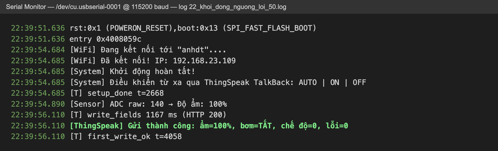

*Hình 2.8. Khởi động: kết nối WiFi, đọc cảm biến và gửi gói dữ liệu đầu tiên*

Từ lúc chip reset tới `setup_done` mất 2.67 s, chủ yếu là kết nối WiFi; vòng lặp đầu đọc cảm biến rồi gửi ngay gói đầu tiên (HTTP 200) lúc t = 4.06 s — đây là chỉ tiêu NFR5 (đo 7 lần, TB 3.79 s).

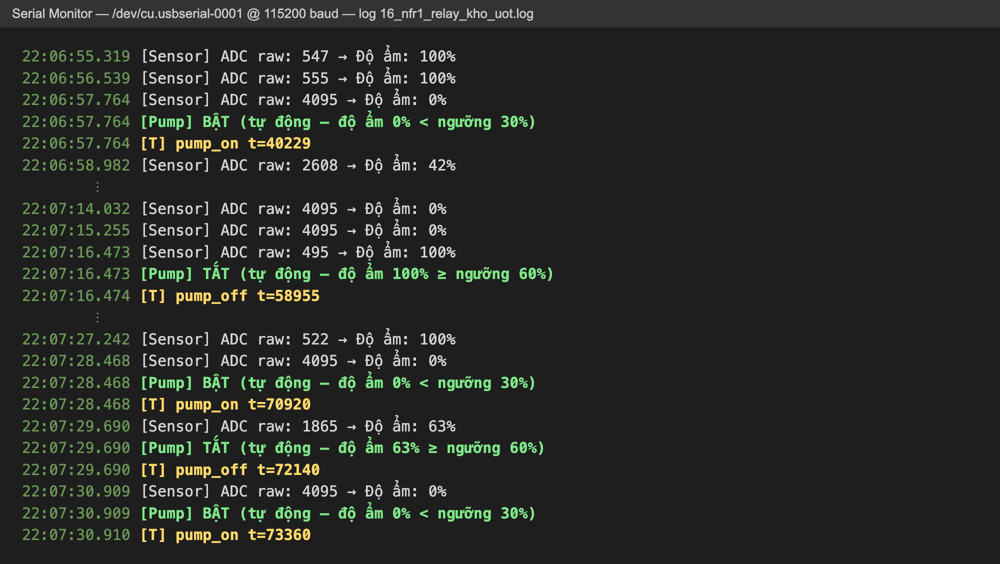

*Hình 2.9. Chế độ AUTO bật/tắt relay theo độ ẩm (thử khi chưa cấp 12 V cho bơm, quan sát relay)*

Nhấc đầu dò khỏi nước, ADC lên 4095 (0 %) và relay đóng ngay trong vòng đọc đó (`pump_on`). Lần đọc kế tiếp 42 % — nằm giữa hai ngưỡng — bơm **vẫn chạy**, vì chỉ tắt khi ≥ 60 %: đây là vùng trễ hoạt động. Nhúng lại, ẩm 100 % → tắt. Đoạn cuối: đầu dò nhúng nông, đọc 63 % → tắt (≥ 60 %), nhấc ra → 0 % → bật lại.

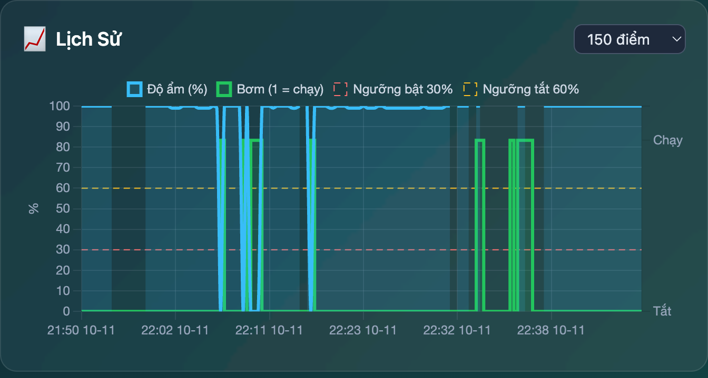

*Hình 2.10. Biểu đồ lịch sử 150 điểm gần nhất trên dashboard (21:50–22:47, 10/11/2026)*

Đường xanh dương là độ ẩm, đường xanh lá là trạng thái bơm (field2), hai đường đứt là ngưỡng bật 30 % và tắt 60 %. Đọc theo thời gian:
- **22:07–22:16:** các lần thử chế độ AUTO ở Hình 2.9 — mỗi lần nhấc đầu dò ra, độ ẩm về 0 % và bơm lên "Chạy"; nhúng lại, độ ẩm 100 % và bơm về "Tắt".
- **22:33–22:37:** bơm "Chạy" trong khi độ ẩm vẫn 100 % — đây là các lần bấm "Bật Bơm" trên dashboard khi đo NFR2 (Hình 2.11): chế độ thủ công bỏ qua độ ẩm (FR3).
- Các dải nền tối là những entry không có giá trị độ ẩm: lúc rút dây cảm biến (Hình 2.12, field1 để trống) và các entry rỗng do TalkBack ghi vào channel (3.3).

Hai hạn chế của biểu đồ: (1) dữ liệu chỉ có 20 s/điểm nên lần bật–tắt kéo dài 1 s lúc 22:07:28 (Hình 2.9) không hiện; (2) trục ngang xếp điểm theo thứ tự chứ không theo thời gian thật, nên 127 s mất WiFi lúc 22:20–22:22 không hiện thành khoảng trống — có thể sửa bằng trục thời gian (`type: 'time'`) của Chart.js.

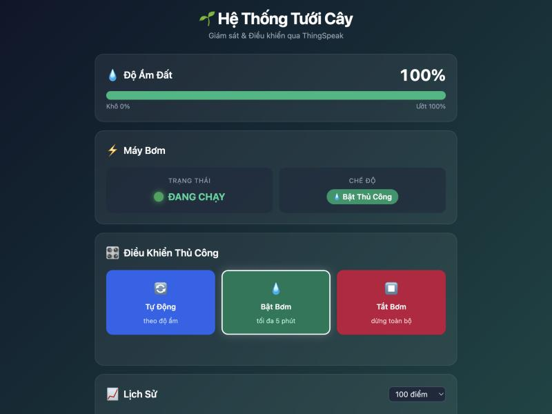

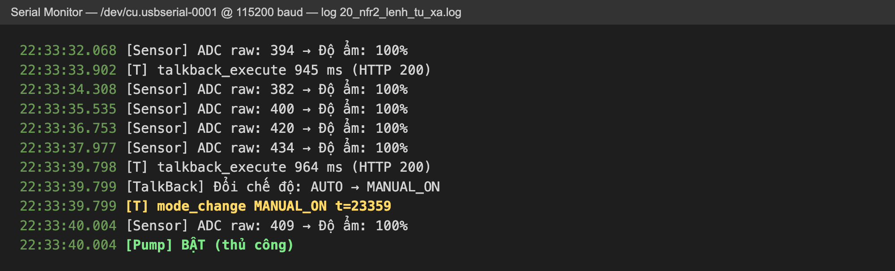

*Hình 2.11. Điều khiển từ xa: (a) dashboard sau khi bấm "Bật Bơm"; (b) log Serial cùng thời điểm*

Nút được bấm lúc 22:33:32.353. Lượt hỏi TalkBack lúc 22:33:33.9 còn trống (lệnh chưa kịp vào hàng đợi); lượt kế tiếp 5 s sau lấy được lệnh `ON`, firmware chuyển AUTO → MANUAL_ON và bật relay — tổng 7.45 s, lần chậm nhất trong 5 lần đo NFR2. Dashboard cập nhật trạng thái "ĐANG CHẠY / Bật Thủ Công" từ gói dữ liệu ESP32 gửi sớm ngay sau khi đổi chế độ, nên hiển thị đúng trạng thái thật của thiết bị chứ không phải lệnh vừa bấm.

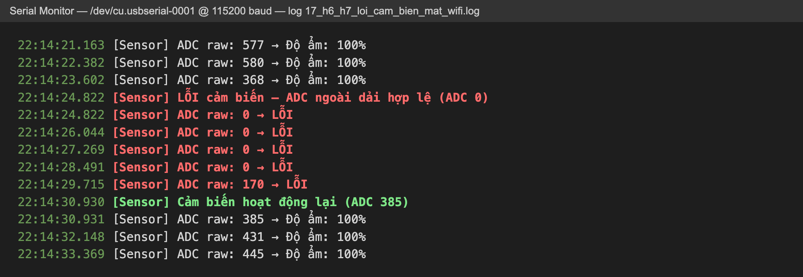

*Hình 2.12. Rút dây VCC của cảm biến rồi cắm lại*

Rút dây VCC (chân GPIO25), AO về 0 — thấp hơn ngưỡng lỗi — nên firmware báo `LỖI cảm biến` ngay ở lần đọc đầu, trả về −1 để AUTO giữ bơm tắt và gửi mã lỗi 1 trong field4 (lần thử này dashboard chưa hiện cảnh báo vì Field 4 chưa được bật trên channel — xem 3.3). Cắm lại, ADC về dải hợp lệ và trạng thái lỗi tự xóa.

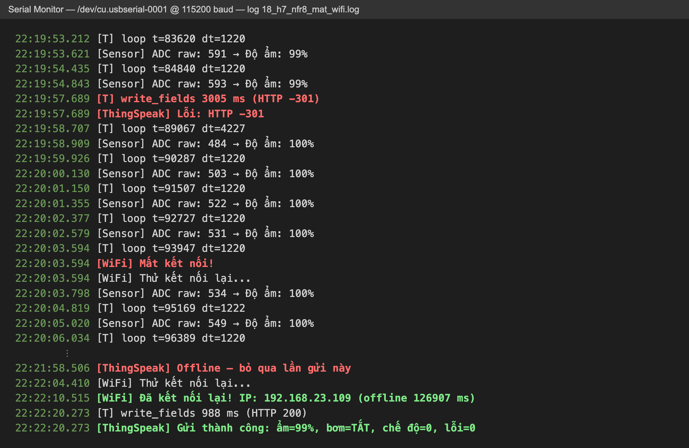

*Hình 2.13. Tắt điểm phát WiFi 127 s rồi bật lại*

Lần ghi đầu tiên sau khi mạng mất bị lỗi (HTTP −301) và chặn vòng lặp 3 s (`dt=4227`). Từ khi firmware nhận ra mất kết nối, vòng lặp trở lại đúng 1220 ms, vẫn đọc cảm biến đều; các lần gửi bị bỏ qua thay vì chờ mạng. Khi có mạng lại, ESP32 tự kết nối (`offline 126907 ms`) và gửi thành công 10 s sau. Trong mỗi vòng lặp đó, `controlPump()` chạy ngay sau lần đọc cảm biến và không kiểm tra trạng thái WiFi (sơ đồ luồng Hình 2.4), nên logic bật/tắt bơm khi mất mạng giống hệt lúc có mạng — đã thấy ở Hình 2.9.

---

## Phần 3. Đánh giá hệ thống

### 3.1 Hiệu năng

Đo bằng log `[T]` của firmware (`DEBUG_TIMING 1`), thời gian trong log gồm `millis()` của ESP32 và giờ của máy tính ghi log qua Serial. ESP32 kết nối WiFi phát trong nhà; trong buổi đo, chất lượng mạng thay đổi (lúc tốt mỗi request ~1 s, lúc chậm tới 5 s).

| Chỉ tiêu | Cách đo (log firmware) | Lý thuyết | Kết quả (TB / min / max, số lần) |
|---|---|---|---|
| Chu kỳ vòng lặp (vòng không có HTTP) | `[T] loop t=… dt=…` | 1.22 s (1 s delay + 200 ms chờ cảm biến + 20 ms lấy mẫu) | 1220 ms ở hầu hết các vòng (vd 59/60 vòng trong một lần chạy, vòng còn lại 1219 ms) |
| Chu kỳ vòng lặp (vòng có ghi channel) | như trên | 1.22 s + thời gian 1 request | 2.13–2.46 s khi mạng tốt; tới 6.57 s khi mạng chậm |
| Độ trễ cục bộ (NFR1) | Nhấc đầu dò khỏi nước / nhúng lại → `[T] pump_on/off t=…`, chưa cắm 12 V (chỉ nghe relay) | thời gian chờ lần đọc kế tiếp (0 … 1 chu kỳ loop) + 0.22 s đọc | Relay đổi trạng thái 220–221 ms sau đầu vòng (= ngay sau khi đọc xong). Tổng: ≤ 1.44 s ở 7/11 lần; 3.4–6.8 s ở 4/11 lần rơi đúng sau vòng có ghi channel |
| Độ trễ lệnh từ xa (NFR2) | Bấm nút trên dashboard (ghi giờ bằng JavaScript trên cùng máy tính) → `[T] mode_change` trong log Serial | 0–5 s chờ chu kỳ hỏi + 1 request backend → TalkBack + 1 request TalkBack + tối đa 1 vòng loop | 3.97 s / 0.92 / 7.51 (n = 5, các lệnh ON, AUTO, OFF, AUTO, ON) |
| Chu kỳ cập nhật cloud (NFR3) | Khoảng cách giữa các dòng `Gửi thành công` | 20 s | 20.66 s / 16.71 / 24.21 (n = 25) — dao động do thời gian request thay đổi |
| Thời gian 1 request ghi channel | `[T] write_fields … ms` | | Mạng tốt: 977 ms / 789 / 1210 (n = 11). Mạng chậm: 916–5344 ms (n = 12), 1 lần timeout HTTP −304 mất 5.34 s |
| Thời gian 1 request TalkBack | `[T] talkback_execute … ms` | | 1529 ms / 848 / 4617 (n = 31, HTTP 200); 1 lần lỗi HTTP −11 sau 5340 ms |
| Thời gian khởi động (NFR5) | `[T] first_write_ok t=…` (reset bằng chân EN, mỗi lần cách ≥ 20 s) | thời gian kết nối WiFi + 1 request | 3.79 s / 3.36 / 4.13 (n = 7); `setup_done` lúc 2.1–2.7 s |
| Chu kỳ khi mất WiFi (NFR8) | Tắt điểm phát WiFi 127 s, xem `dt` | 1.22 s (không còn request HTTP) | 1220 ms / 1220 / 1229 (n = 104) |
| Watchdog (NFR9) | Bản firmware thử: `while(true){}` sau 15 s, đo từ `hang_start` tới thông báo `task_wdt` và `setup_done` kế tiếp | 30 s | Kích sau 29.98 s / 29.90 / 30.11; chạy lại sau 32.91 s / 32.54 / 33.35 (n = 5) |

**Nhận xét.**
- Phần đọc cảm biến → điều khiển relay chạy cục bộ và gần như không tốn thời gian xử lý: relay đổi trạng thái ngay trong vòng phát hiện vượt ngưỡng. Khi mất WiFi, vòng lặp giữ đúng 1220 ms (NFR8), chứng tỏ cơ chế kết nối lại không chặn.
- **Điểm yếu đo được:** request HTTP tới ThingSpeak là lời gọi **đồng bộ** nằm trong `loop()`. Trong lúc chờ phản hồi (1–5 s), firmware không đọc cảm biến, nên sự kiện đất khô xảy ra đúng lúc đó bị trễ tới 6.8 s và NFR1 không đạt ở trường hợp xấu nhất. Chậm vài giây không gây hại cho việc tưới cây (độ ẩm đất thay đổi theo phút), nhưng ở chiều ngược lại — đất đã đủ ẩm — bơm có thể chạy thừa thêm tới ~6 s (~0.2 L). Cải tiến đề xuất ở 3.5.
- Độ trễ lệnh từ xa đo được TB 3.97 s, tối đa 7.51 s — đạt chỉ tiêu 10 s, và giảm rõ so với tối đa ~35 s ở phiên bản đầu (chu kỳ đọc 15 s, lệnh có thể bị ghi đè). Độ trễ dao động 0.9–7.5 s vì gồm thời gian chờ tới lượt hỏi kế tiếp (0–5 s) cộng hai request mạng (mỗi request 0.85–4.6 s). Đổi lại, ESP32 gọi TalkBack mỗi 5 s, tức ~17 000 request/ngày dù phần lớn hàng đợi trống.
- Thời gian khởi động 3.8 s chủ yếu là thời gian kết nối WiFi (~2.5 s) cộng 1 request (~1 s), nhỏ hơn nhiều so với chỉ tiêu 30 s.

### 3.2 Tiêu thụ năng lượng

> ⚠️ Nhóm **không có dụng cụ đo dòng** (USB tester hoặc đồng hồ vạn năng), nên các số dưới đây là **ước tính** từ datasheet linh kiện kết hợp với tỷ lệ thời gian thực tế đo được trong log, chưa phải số đo trực tiếp. Phương pháp đo đề xuất khi có dụng cụ: cắm USB tester giữa cáp và máy tính, cho hệ thống chạy 10 phút và đọc mAh tích lũy (dòng TB = mAh × 6), đo riêng từng trạng thái bằng cách bật/tắt relay từ dashboard.

**Cách ước tính.** Mạch ổn áp trên ESP32 DevKit là ổn áp tuyến tính (AMS1117), nên dòng lấy từ 5 V xấp xỉ dòng tiêu thụ ở 3.3 V cộng dòng tĩnh của các linh kiện trên board. Từ log khi đo NFR2 (230 s, mạng chậm), ESP32 dành **40 %** thời gian cho request HTTP (`talkback_execute` + `write_fields`) và 60 % ở trạng thái chờ (`delay`, đọc cảm biến).

| Thành phần / trạng thái | Dòng (mA) | Nguồn số liệu | Tỷ lệ thời gian | Đóng góp TB (mA) |
|---|---:|---|---:|---:|
| ESP32 chờ (CPU 240 MHz, WiFi giữ kết nối, modem-sleep) | 30–68 | ESP32 datasheet [1] | 60 % | 18–41 |
| ESP32 đang gửi/nhận HTTP (RX 95–100 mA, các xung TX 180–240 mA) | ~95–140 | ESP32 datasheet [1] | 40 % | 38–56 |
| Chip USB-UART CP2102 + dòng tĩnh ổn áp + LED nguồn trên DevKit | ~20–30 | ước tính | 100 % | 20–30 |
| Cảm biến độ ẩm (< 20 mA khi cấp nguồn) | < 20 | thông số nhà bán | ~18 % (220 ms / 1.22 s) | < 3.6 |
| **Tổng, relay nhả** | | | | **~80–130 (TB ~105) → ~0.5 W** |
| Relay kênh 1 đóng: cuộn hút SRD-05VDC (70 Ω → 71 mA) + LED + opto | ~80 | datasheet relay [8] | khi bơm chạy | +80 |
| **Đỉnh tức thời**: TX 240 mA + board 30 + cảm biến 20 + relay 80 | **~370** | | | |
| Bơm chạy (12 V, nguồn riêng) | 600–2000 (adapter 1 A giới hạn ở ~1000) | thông số nhà bán | | 5–12 W (thực tế ≤ 12 W do adapter) |

- **Ngân sách dòng phía USB:** đỉnh ~370 mA < 500 mA của cổng USB 2.0 → đạt, còn dư ~25 %. Trung bình ~105 mA khi relay nhả, ~185 mA khi relay đóng.
- **Năng lượng mỗi ngày:** phần điều khiển chạy liên tục 0.5 W × 24 h ≈ **12.6 Wh** (khoảng 9.6–15.6 Wh). Bơm giả sử tưới 2 lần/ngày, mỗi lần 3 phút: 12 W × 6 phút ≈ **1.2 Wh**. Như vậy dù bơm có công suất lớn gấp ~20 lần phần điều khiển, **phần điều khiển vẫn chiếm ~90 % năng lượng mỗi ngày** vì nó không bao giờ nghỉ.
- **Tác động của thiết kế lên năng lượng:** WiFi luôn bật và hỏi TalkBack mỗi 5 s là lý do ESP32 dành tới 40 % thời gian ở trạng thái thu/phát. Nếu chuyển sang MQTT (không phải hỏi), hoặc light/deep sleep giữa các lần đo khi bơm tắt, dòng trung bình có thể giảm xuống dưới 10 mA → phù hợp chạy pin (xem 3.5). Việc cấp nguồn cảm biến qua GPIO (2.2) ngoài mục đích giảm phân cực cũng cắt ~80 % năng lượng của cảm biến.
- Mỗi phút bơm cấp 1.8 L nước và tiêu thụ tối đa 12 W × 60 s = 720 J (0.2 Wh). Giới hạn 5 phút thủ công và kiểm tra bơm hiệu quả (3 phút) đồng thời chặn trên năng lượng bơm lãng phí.

### 3.3 Độ tin cậy

| Tình huống lỗi | Hành vi | Đánh giá |
|---|---|---|
| Mất WiFi khi khởi động | `startWiFi()` chờ tối đa 10 s rồi chạy offline, thử lại nền | Ổn — vẫn tưới tự động |
| Mất WiFi khi đang chạy | Đã thử: tắt điểm phát 127 s → `Mất kết nối!`, thử lại mỗi ~11 s, 6 lần gửi bị bỏ qua, vòng lặp vẫn 1220 ms; bật lại → `Đã kết nối lại`, gửi thành công 10 s sau. `maintainWiFi()` reconnect mỗi 10 s không chặn; đọc cảm biến/điều khiển bơm vẫn chạy mỗi ~1.2 s; offline > 60 s ở chế độ thủ công → về AUTO | Ổn |
| ThingSpeak/TalkBack lỗi, HTTP ≠ 200 | Bỏ qua lượt đó, giữ chế độ cũ, log lỗi | Ổn |
| Mạng chậm / server phản hồi chậm | Request ghi channel mất tới 5.3 s (đo được, có lần timeout HTTP −304); trong thời gian đó `loop()` bị chặn, không đọc cảm biến | ⚠️ Trễ điều khiển tới 6.8 s (3.1); chưa nguy hiểm vì watchdog 30 s vẫn đủ rộng |
| Người dùng gửi lệnh đúng lúc ESP32 gửi dữ liệu | Lệnh nằm trong hàng đợi TalkBack riêng, không bị ghi đè; ESP32 lấy ở lượt hỏi kế tiếp | Ổn |
| Request lấy lệnh bị lỗi mạng giữa chừng | Đã gặp khi đo NFR2: `talkback_execute` trả HTTP −11 sau 5.34 s, lệnh `AUTO` **bị mất** — `commands/execute` lấy và **xóa** lệnh khỏi hàng đợi trên server trước khi trả về, phản hồi lạc thì ESP32 không bao giờ nhận được. ESP32 giữ chế độ cũ (MANUAL_ON); dashboard vẫn hiển thị đúng chế độ thật vì đọc từ field3 do ESP32 gửi | ⚠️ Mất lệnh (1/6 lần đo). Bơm vẫn tự về AUTO sau 5 phút nhờ giới hạn MANUAL_ON |
| Cấu hình ThingSpeak sai (phát hiện khi chạy dashboard) | (1) TalkBack được tạo với tùy chọn *Log to Channel* trỏ về chính channel dữ liệu → mỗi lệnh sinh 1 entry rỗng (chỉ có `status`), dashboard hiện độ ẩm "—" và lần ghi của ESP32 ngay sau đó bị từ chối vì vi phạm 15 s (HTTP −401). (2) Field 4 chưa được bật trong channel → mã lỗi không được lưu, dashboard không bao giờ thấy cảnh báo lỗi | ⚠️ Lỗi cấu hình, không phải lỗi code. Khắc phục: đặt *Log to Channel* của TalkBack về *None*, bật Field 4 ("Ma loi") trong *Channel Settings*. Bài học: nên kiểm tra cấu hình cloud bằng chính dashboard trước khi đo |
| Cảm biến rời dây VCC/GND, chập đầu dò | ADC < `SENSOR_FAULT_LOW` = 50 → field1 để trống, AUTO tắt bơm, field4 = 1, dashboard cảnh báo | Ổn |
| Đứt dây đầu dò (hở mạch) | ADC = 4095, giống hệt đất khô → AUTO **bật bơm**; sau 3 phút độ ẩm không tăng → tắt bơm, field4 = 2 | ⚠️ Phát hiện muộn 3 phút (≤ 5.4 L nước) và báo sai loại lỗi. Nguyên nhân: mốc khô đã chạm trần ADC nên không còn dải phía trên để phân biệt |
| Bồn hết nước / tắc ống | AUTO bơm 3 phút mà ẩm tăng < 5 % → tắt bơm, chốt lỗi field4 = 2 tới khi người dùng xác nhận | Ổn — tránh bơm chạy khô |
| Quên tắt bơm ở MANUAL_ON | Sau 5 phút tự về AUTO (≤ 9 L nước) | Ổn |
| Firmware treo (VD request HTTP kẹt) | Watchdog 30 s reset ESP32; relay khởi tạo LOW → bơm tắt | Ổn |
| Bơm kéo quá dòng adapter (tải nặng, tắc ống) | Adapter 1 A sụt áp hoặc ngắt bảo vệ → bơm yếu/dừng, độ ẩm không tăng → sau 3 phút AUTO tắt bơm, field4 = 2 (FR9). Mạch điều khiển dùng nguồn USB riêng nên ESP32 không bị ảnh hưởng | ⚠️ Chưa thử với bơm thật; nên thay adapter ≥ 2 A |
| Mất điện, khởi động lại | Relay khởi tạo LOW (tắt), chế độ về AUTO mặc định | Ổn |
| Phân cực / ăn mòn điện cực | Đã giảm bằng cách chỉ cấp nguồn cảm biến ~18 % thời gian: trong nước số đo ổn định sau ~2 phút (σ ≈ 0.4 %) thay vì trôi ~100 ADC/phút (2.2) | ⚠️ Vẫn có điện một chiều khi đọc nên điện cực vẫn ăn mòn chậm khi dùng lâu |
| Reset liên tiếp nhanh (< 15 s) | Lần ghi đầu sau khởi động bị ThingSpeak từ chối (HTTP −401, quá giới hạn 15 s); lần gửi định kỳ sau 20 s thành công. Đo thực tế: gói đầu tiên thành công lúc 3.5 s khi khởi động bình thường, 24.6 s khi reset ngay sau lần ghi trước | ⚠️ Nhỏ — chỉ trễ dữ liệu đầu tiên |
| Lần gửi sớm khi đổi chế độ | Khoảng cách 15.5 s tính từ **đầu vòng lặp**, không phải lúc ghi thật; vòng trước có request TalkBack chậm thì 2 lần ghi thật có thể cách < 15 s → ThingSpeak từ chối lần ghi đó | ⚠️ Nhỏ — lần gửi định kỳ sau 20 s vẫn cập nhật |

### 3.4 Khả năng mở rộng

- **Thêm cảm biến** (nhiệt độ/độ ẩm không khí DHT22, mức nước bồn, ánh sáng): còn field 5–8 trên ThingSpeak và nhiều chân ADC1/GPIO trống. Cảm biến mức nước bồn sẽ phát hiện hết nước sớm hơn cơ chế 3 phút hiện tại.
- **Kênh relay thứ 2 đang trống:** thêm ngay bơm thứ 2/van điện từ cho vùng tưới thứ 2, hoặc đèn/quạt, mà không cần thêm phần cứng điều khiển (tiếp điểm 10 A chịu được cả tải 220 VAC nhỏ). Lệnh TalkBack là chuỗi tự do nên chỉ cần thêm lệnh mới (VD `ON2`/`OFF2`).
- **Nhiều vùng tưới:** mỗi vùng 1 cảm biến + 1 relay; hoặc nhiều node ESP32, mỗi node 1 channel + 1 TalkBack, backend gộp lại.
- **Giới hạn:** ThingSpeak 15 s/lần ghi, mỗi channel 8 field, lệnh phải hỏi theo chu kỳ → khi số node lớn nên chuyển sang MQTT broker.

### 3.5 Hạn chế và đề xuất cải tiến

#### Các cải tiến đã thực hiện so với phiên bản đầu

| Phiên bản đầu (`a4c7f99`) | Phiên bản hiện tại |
|---|---|
| Mất WiFi → `loop()` dừng, bơm đang bật không tắt được | WiFi không chặn, điều khiển cục bộ chạy liên tục |
| Lệnh và trạng thái dùng chung field3 → lệnh có thể bị ghi đè; dashboard đụng giới hạn 15 s; entry thiếu field làm dashboard hiện `null` | Lệnh qua TalkBack riêng; chỉ ESP32 ghi channel |
| Độ trễ lệnh từ xa tới ~35 s | ~5 s + thời gian request |
| MANUAL_ON không giới hạn | Tối đa 5 phút |
| Không phát hiện cảm biến hỏng, bơm chạy khô | Mã lỗi field4, tắt bơm, cảnh báo trên dashboard |
| Không có watchdog | Task Watchdog 30 s |
| API key, mật khẩu WiFi ghi thẳng trong code | Tách ra `secrets.h` (không commit) |
| Dashboard chỉ có giá trị mới nhất | Biểu đồ lịch sử, cảnh báo mất kết nối |
| Cảm biến cấp 3V3 liên tục → ADC trôi ~100 đơn vị/phút trong nước | Cấp nguồn qua GPIO25 chỉ lúc đọc, chờ 200 ms → ổn định sau ~2 phút, σ ≈ 0.4 % |

#### Hạn chế còn lại

| Hạn chế | Đề xuất cải tiến cụ thể |
|---|---|
| Request HTTP đồng bộ trong `loop()` chặn vòng điều khiển 1–5 s (đo được, làm NFR1 trễ tới 6.8 s) | Tách phần mạng sang một task FreeRTOS riêng trên core 0 (ESP32 có 2 nhân), giao tiếp với vòng điều khiển qua hàng đợi (`xQueue`); vòng điều khiển ở core 1 không bao giờ chờ mạng. Đồng thời đặt timeout HTTP ngắn hơn (VD 2 s) |
| Lệnh từ xa vẫn phải hỏi theo chu kỳ 5 s (polling) → có độ trễ và tốn request | MQTT subscribe → lệnh đến gần như tức thời, không cần hỏi |
| Lệnh có thể bị mất khi request `commands/execute` lỗi giữa chừng (lấy-và-xóa, giao *nhiều nhất một lần*) | Đọc lệnh bằng `commands.json` rồi chỉ xóa (`DELETE commands/<id>`) sau khi đã áp dụng → giao *ít nhất một lần*; lệnh là đặt chế độ tuyệt đối (`ON`/`OFF`/`AUTO`) nên nhận trùng không gây hại. Hoặc dashboard so chế độ yêu cầu với field3 và gửi lại nếu sau ~15 s chưa khớp |
| Request ThingSpeak/TalkBack đi qua `http://` → API key truyền dạng rõ trên mạng | Dùng HTTPS (`WiFiClientSecure`) |
| Mật khẩu WiFi biên dịch cứng trong firmware | WiFiManager: cấu hình WiFi qua điểm phát AP lúc đầu |
| Khoảng cách gửi sớm tính từ đầu vòng lặp (3.3) | Lưu `lastSendTime = millis()` ngay sau `writeFields` |
| Bơm là tải cảm (động cơ DC): khi relay ngắt sinh xung điện áp ngược, gây tia lửa ở tiếp điểm và nhiễu | Mắc diode dập (1N4007/1N5819) song song ngược chiều với bơm, có thể thêm tụ 100 nF; về lâu dài thay relay bằng MOSFET logic-level |
| Đầu dò điện trở vẫn ăn mòn chậm (dòng một chiều lúc đọc); thời gian chờ 200 ms do mạch RC trên module | Đảo cực nguồn đầu dò giữa các lần đọc (dùng 2 GPIO) để triệt tiêu điện phân; hoặc thay bằng cảm biến điện dung (không có điện cực tiếp xúc nước) |
| Mốc khô chạm trần ADC (4095) → không phân biệt được đứt dây đầu dò với đất khô | Thêm cầu chia áp ở ngõ AO để mốc khô < ~3800; khi đó ADC = 4095 nghĩa là hở mạch → báo lỗi ngay thay vì chờ 3 phút |
| Phát hiện hết nước phải chờ 3 phút bơm | Thêm cảm biến mức nước trong bồn |
| Adapter bơm chỉ 1 A, trong khi bơm cần tới 2 A khi tải nặng/khởi động → có thể sụt áp làm bơm yếu, adapter nóng hoặc tự ngắt bảo vệ | Thay adapter 12 V ≥ 2 A (khuyến nghị 2.5 A để dư 20 %); hoặc khởi động mềm bằng MOSFET + PWM tăng dần để giảm dòng khởi động |
| Tiêu thụ năng lượng cao (WiFi luôn bật, không ngủ) | Light/deep sleep giữa các lần đo khi bơm tắt, giãn chu kỳ hỏi lệnh khi không có người dùng |

---

## Kết luận

**Mức độ đáp ứng yêu cầu.** Hệ thống đáp ứng đủ 10 yêu cầu chức năng FR1–FR10, đã thử trên mạch thật: tưới tự động theo ngưỡng 30 %/60 %, báo lỗi khi rút dây cảm biến, tiếp tục điều khiển khi mất WiFi 127 s rồi tự kết nối lại, watchdog khởi động lại khi firmware treo. Về chỉ tiêu định lượng: thời gian khởi động đến gói dữ liệu đầu tiên 3.79 s (chỉ tiêu ≤ 30 s), chu kỳ cập nhật cloud 20.66 s (20 s), watchdog phục hồi sau 29.98 s (≤ 30 s), sai số độ ẩm ±1 % sau khi đầu dò ổn định (≤ ±5 %). Khi mất WiFi, chu kỳ điều khiển giữ đúng 1220 ms (≤ 2 s), nghĩa là việc tưới không phụ thuộc Internet. Chỉ tiêu độ trễ cục bộ NFR1 (≤ 2 s) chỉ đạt ở 7/11 lần đo (≤ 1.44 s); các lần còn lại trễ tới 6.8 s vì request HTTP đồng bộ chặn vòng điều khiển khi mạng chậm. Lệnh từ xa đến ESP32 sau TB 3.97 s (tối đa 7.51 s, chỉ tiêu ≤ 10 s), nhưng 1/6 lệnh bị mất khi request lấy lệnh lỗi giữa chừng.

**Các quyết định thiết kế chính.**
1. *Điều khiển cục bộ, mạng chỉ là kênh phụ.* Đọc cảm biến và quyết định bật/tắt bơm chạy trong mọi vòng `loop()` trên ESP32. Các tác vụ mạng được giãn chu kỳ bằng `millis()` và không bao giờ chờ kết nối, nên mất WiFi hoàn toàn không làm gián đoạn việc tưới (đo được: chu kỳ giữ 1220 ms khi offline 127 s). Trường hợp còn ảnh hưởng là mạng *chậm*: request HTTP đồng bộ làm vòng điều khiển trễ tới vài giây (xem hạn chế bên dưới).
2. *Vùng trễ 30–60 %.* Hai ngưỡng tách nhau 30 điểm phần trăm, lớn hơn nhiều so với dao động của phép đo, nên bơm không đóng/ngắt liên tục quanh một ngưỡng. Điều này bảo vệ tiếp điểm relay và động cơ bơm.
3. *Tách kênh dữ liệu và kênh lệnh.* ESP32 là bên duy nhất ghi vào Channel, dashboard là bên duy nhất ghi vào TalkBack. Thiết kế này loại bỏ lỗi ghi đè lệnh của phiên bản đầu và đưa độ trễ lệnh từ ~35 s xuống còn chu kỳ hỏi 5 s cộng thời gian một request.
4. *Mọi lỗi đều dẫn về trạng thái bơm tắt.* Relay dùng tiếp điểm thường mở và kích mức cao, nên lúc khởi động, lúc watchdog reset hay khi mất nguồn điều khiển bơm đều tắt. Cảm biến lỗi, bơm 3 phút không làm tăng độ ẩm, hay quên tắt chế độ thủ công đều có điều kiện thoát riêng. Lượng nước tối đa của một lần bật thủ công bị chặn ở 9 L.

**Hạn chế và hướng phát triển.** Hạn chế lớn nhất đo được là phần mạng chạy đồng bộ trong cùng vòng lặp với phần điều khiển: một request chậm 5 s làm vòng điều khiển dừng 5 s. Cải tiến ưu tiên là tách mạng sang task FreeRTOS riêng trên nhân thứ hai của ESP32. Kênh lệnh cũng vẫn dựa trên polling 5 s qua HTTP không mã hóa (khoảng 17 000 request mỗi ngày, API key đi dạng rõ); chuyển sang MQTT qua TLS sẽ vừa nhận lệnh gần như tức thời vừa bảo mật kênh truyền. Hạn chế thứ hai nằm ở cảm biến điện trở: quá trình hiệu chuẩn cho thấy cấp điện liên tục làm số đo trôi ~100 ADC/phút do phân cực điện cực. Nhóm đã khắc phục bằng cách chỉ cấp nguồn cho cảm biến qua GPIO25 trong ~220 ms mỗi lần đọc, nhờ đó số đo trong nước ổn định với σ ≈ 0.4 %; tuy vậy điện cực vẫn ăn mòn chậm và mốc khô chạm trần ADC khiến đứt dây đầu dò bị nhầm thành đất khô. Hướng xử lý triệt để là cảm biến điện dung kết hợp cầu chia áp ở ngõ AO. Với các cải tiến này cùng chế độ ngủ giữa các lần đo, hệ thống có thể mở rộng thành nhiều vùng tưới (kênh relay 2 đang để trống) và chạy bằng pin cho vườn không có sẵn ổ điện.

---

## Tài liệu tham khảo

> 📝 Định dạng IEEE. Mục [8], [9]: module relay 5 V phổ biến dùng relay Songle SRD-05VDC-SL-C và opto PC817 — đối chiếu chữ in trên relay/opto của module thật, khác thì sửa tên linh kiện.

[1] Espressif Systems, "ESP32 Series Datasheet." [Online]. Available: https://www.espressif.com/en/support/documents/technical-documents (accessed Nov. 10, 2026).

[2] Espressif Systems, "ESP32 Technical Reference Manual," ch. "On-Chip Sensors and Analog Signal Processing (SAR ADC)." [Online]. Available: https://www.espressif.com/en/support/documents/technical-documents (accessed Nov. 10, 2026).

[3] Espressif Systems, "ESP-IDF Programming Guide: ADC, Wi-Fi Driver, Watchdogs." [Online]. Available: https://docs.espressif.com/projects/esp-idf/ (accessed Nov. 10, 2026).

[4] MathWorks, "ThingSpeak Documentation: Write Data, Read Data, Rate Limits." [Online]. Available: https://www.mathworks.com/help/thingspeak/ (accessed Nov. 10, 2026).

[5] MathWorks, "ThingSpeak: Execute TalkBack Command." [Online]. Available: https://www.mathworks.com/help/thingspeak/executetalkbackcommand.html (accessed Nov. 10, 2026).

[6] MathWorks, "ThingSpeak Communication Library for Arduino, ESP8266 and ESP32," GitHub repository. [Online]. Available: https://github.com/mathworks/thingspeak-arduino (accessed Nov. 10, 2026).

[7] Texas Instruments, "LMx93-N, LM2903-N Low-Power, Low-Offset Voltage, Dual Comparators," LM393 datasheet. [Online]. Available: https://www.ti.com/product/LM393 (accessed Nov. 10, 2026).

[8] Ningbo Songle Relay Co., Ltd., "SRD Series Relay (SRD-05VDC-SL-C)," datasheet.

[9] Sharp Corporation, "PC817X Series Photocoupler," datasheet.

[10] NestJS, "NestJS Documentation." [Online]. Available: https://docs.nestjs.com (accessed Nov. 10, 2026).

[11] Chart.js, "Chart.js Documentation." [Online]. Available: https://www.chartjs.org/docs/ (accessed Nov. 10, 2026).

[12] PlatformIO Labs, "PlatformIO Documentation: Espressif 32 Platform." [Online]. Available: https://docs.platformio.org/en/latest/platforms/espressif32.html (accessed Nov. 10, 2026).

---

## Checklist trước khi nộp

> 📝 `[x]` = đã xong trong file này; `[ ]` = còn việc. Danh sách việc chi tiết: [checklist.md](checklist.md).

### Đã xong

- [x] Bảng đặc tả Input/Output/Ràng buộc (1.2)
- [x] Yêu cầu chức năng FR1–FR10 và chỉ tiêu phi chức năng NFR1–NFR10 có số (1.3, 1.4)
- [x] Sơ đồ khối + bảng giải thích từng khối (2.1)
- [x] Bảng linh kiện đủ thông số + lý do chọn + phương án thay thế (2.2)
- [x] Bảng đấu dây có lý do từng kết nối (2.3)
- [x] Kiến trúc phần mềm, sơ đồ luồng, 2 máy trạng thái (2.4)
- [x] Giải thích code theo từng hàm, có trích code, gắn với sơ đồ luồng (2.5)
- [x] Phân tích độ tin cậy, khả năng mở rộng (3.3, 3.4)
- [x] Cải tiến đã làm + hạn chế còn lại + đề xuất cụ thể (3.5)
- [x] Repo: tách key ra `secrets.h`, có README
- [x] 1.1 bối cảnh, Kết luận (chờ số đo), Tài liệu tham khảo IEEE
- [x] Ảnh 5 sơ đồ mermaid + sơ đồ đấu dây (thư mục `hinh/`)

### Còn thiếu

**Nội dung**
- [ ] Phần 0: **% công việc** từng người (tổng 100 %)
- [ ] 3.2 + NFR6: đang là **ước tính** — đo bằng USB tester nếu có
- [ ] Kết luận + 1.4 + 3.1: thêm số đo NFR2 (cần TalkBack)
- [ ] Tài liệu tham khảo: đối chiếu tên relay/opto [8], [9] với module thật
- [ ] Cập nhật mã commit ở đầu báo cáo nếu sửa code sau `ab6b2f2`; merge nhánh `feat/sensor-gpio-power` vào `master` và push trước khi nộp

**Hình ảnh**
- [ ] Ảnh mạch thật (H1)
- [ ] Ảnh kết quả H1–H7 + chú thích (2.6)

**Hình thức nộp**
- [ ] ⚠️ Nhóm **6 người**, đề cho tối đa 5 → xác nhận với giảng viên
- [ ] Số thứ tự lớp Y → `HTN_TX_2026 Nhóm 11 Lớp NY.pdf`
- [ ] Format thống nhất (font, đánh số hình/bảng, chú thích)
- [ ] Xóa toàn bộ `TODO` và ghi chú `📝`
